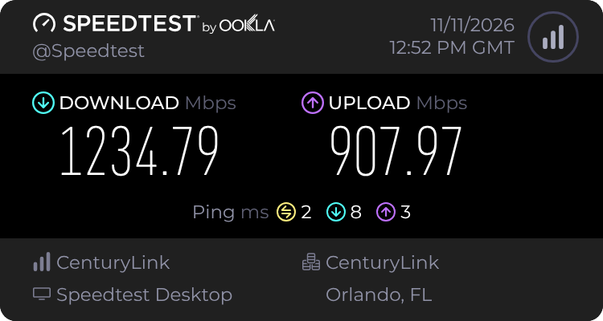

# C6500XK bypass validation on Quantum Fiber XGS-PON

On November 10, 2026, an EXEN X-ONU-SFPP replaced the Gemtek C6500XK on one Quantum Fiber line served by a Calix AXOS OLT. The ONU reached **O5.1**, the router obtained a WAN lease via DHCP, and Internet access worked. The initial direct wired test reached **942.76 Mbps down and 946.12 Mbps up**.

## Setup

| Component | Tested hardware or software |
| --- | --- |
| Original SmartNID | Gemtek C6500XK, EcoNet EN7580, Linux 4.4.115 |
| Replacement ONU | EXEN X-ONU-SFPP, 8311 v2.8.3 Basic, stock `prx300_1U.ini` |
| Switch | SODOLA SL-SWTGW2C48NS |
| Initial router | pfSense 2.8.1 on Intel Atom E3827 |
| Current router | OPNsense with 2.5 GbE WAN and LAN links |

The working setup used an untagged Ethernet handoff from the ONU to the switch. The switch presented tagged VLAN `201` to the router WAN. VLAN `53` appeared in the ONU's service translation. During testing, OMCI restarts removed the working translation. Restoring the rules recovered service. The custom queue profile showed no speed improvement, so the stock profile was restored.

## Wired benchmarks

Tests used Speedtest Desktop against CenturyLink Orlando. The direct and pfSense tests used a 1 GbE PC link. The OPNsense tests used a 2.5 GbE PC link.

| Test path | PC link | Download (Mbps) | Upload (Mbps) |
| --- | ---: | ---: | ---: |
| PC directly through the switch | 1 GbE | 942.76 | 946.12 |
| Through pfSense 2.8.1 | 1 GbE | 646.00 | 945.14 |
| Through OPNsense | 2.5 GbE | 1,235.36 | 825.77 |
| Through OPNsense, repeat test | 2.5 GbE | 1,234.76 | 813.60 |

During the pfSense download, the two cores peaked at 96.5% and 99% busy, mostly in kernel processing. Physical NIC error counts stayed flat. The direct test and later OPNsense tests showed that the ONU could deliver more than the old pfSense download result. The OPNsense tests confirmed download speeds above 1 Gbps.

### November 11 follow-up

The latest CenturyLink Orlando test measured **1,234.79 Mbps down and 907.97 Mbps up**. Latency was 2 ms idle, 8 ms during download, and 3 ms during upload. Upload improved over the two November 10 OPNsense results. The cause of the variation remains open.

These results apply to the tested line, OLT, and hardware. Service profiles and VLAN handoffs can differ by deployment.
